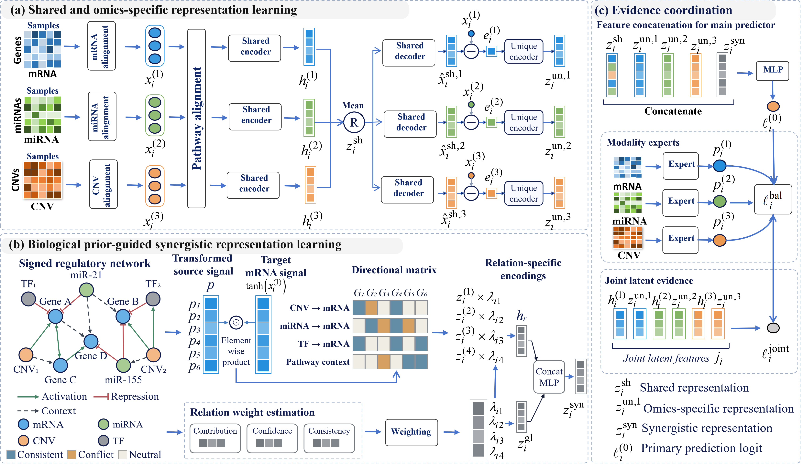

# TriCo

**From Modality Entanglement to Evidence Coordination: Tripartite Disentanglement and Conflict-Aware Prediction for Multi-Omics Cancer Analysis**

TriCo is a multi-omics framework for cancer staging and survival prediction. It integrates mRNA expression, miRNA expression, and copy-number variation (CNV) through structured representation learning and conflict-aware evidence coordination.



## Model overview

TriCo consists of three main components:

1. **Shared and omics-specific representation learning:** uses pathway alignment to learn common molecular representations and residual encoding to capture modality-specific signals.
2. **Prior-guided synergistic representation learning:** incorporates biological regulatory relationships and modulates their contributions according to directional agreement with molecular signals.
3. **Evidence coordination:** combines modality reliability weighting with patient-level prediction-conflict adjustment to coordinate evidence from the primary model and auxiliary predictors.

## Repository contents

```text
TriCo/                  # Directory reserved for model code
assets/fig2.png         # Framework overview
datasets/LGG/           # Example mRNA, miRNA, CNV, and survival labels
KEGG_pathways/          # Pathway annotations
requirements.txt        # Python dependencies
```

## Getting started

Install the dependencies from the repository root:

```bash
pip install -r requirements.txt
```

The LGG example includes `mRNA.csv`, `miRNA.csv`, `cnv_gene.csv`, and `label.csv`. Molecular matrices store features in rows and patients in columns. Survival labels contain `sample_id`, `time`, and `event`; align samples by patient ID before analysis.

## Code availability

This repository currently provides a preview of the example data, biological annotations, dependency specifications, and the TriCo framework overview.

**The full implementation will be publicly released on GitHub upon acceptance of this manuscript.**

## Citation

Citation information will be added upon publication.
